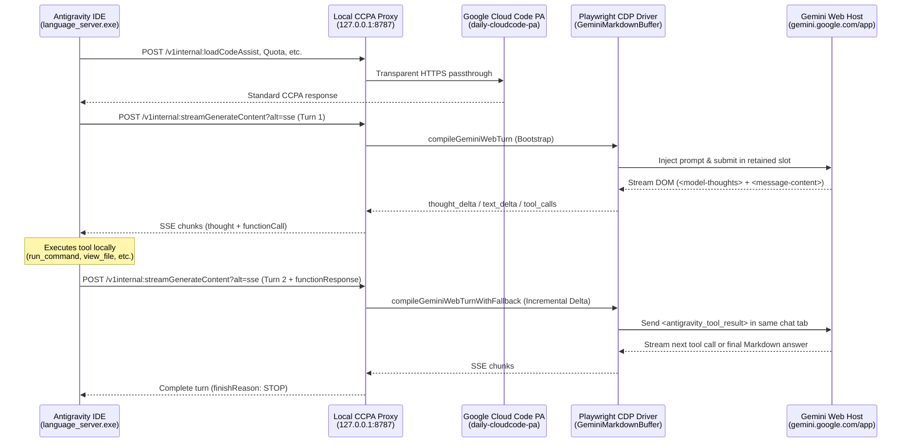

# antigravity-gemini-web

[](./LICENSE)
[](https://nodejs.org/)
[](https://www.typescriptlang.org/)

A local **Cloud Code PA (`v1internal`) reverse proxy and CDP browser driver** that bridges **Google Antigravity IDE** (`language_server.exe`) model inference and local tool execution loops through an authenticated **Gemini Web (`https://gemini.google.com/app`)** browser session.

> **한국어 요약**: Google Antigravity IDE(`language_server.exe`)의 에이전트 추론 및 로컬 도구 실행(`run_command`, `view_file`, `write_to_file`, `replace_file_content` 등) 루프를 로컬 프록시(`127.0.0.1:8787`)와 CDP 브라우저 드라이버(`127.0.0.1:9333`)를 통해 사용자의 **Gemini Web (`gemini.google.com`)** 세션으로 실시간 연결하는 브릿지입니다.

---

## Key Features

- **Selective Cloud Code PA (`v1internal`) Reverse Proxy (`src/proxy/ccpa-server.ts`)**
  - Intercepts `POST /v1internal:streamGenerateContent?alt=sse` and `POST /v1internal:generateContent` requests from Antigravity's `language_server.exe`.
  - Transparently forwards authentication, project onboarding, model catalog, and quota requests (`/v1internal:loadCodeAssist`, `/v1internal:fetchAvailableModels`, `/v1internal:retrieveUserQuotaSummary`, etc.) to `https://daily-cloudcode-pa.googleapis.com`.
  - Fast-paths internal safety classifier requests (`sir_flash_lite`) and passes background helper calls through without occupying a browser tab.

- **Retained-Chat Multi-Turn Tool Protocol (`src/protocol/tool-protocol.ts`)**
  - **Bootstrap Turn**: Compiles `systemInstruction`, `tools.functionDeclarations`, and conversation history into a structured prompt on the first turn (with automatic file attachment fallback when exceeding the inline composer budget).
  - **Structured Tool Call Parsing**: Detects `<antigravity_tool_call>{"name": "...", "args": {...}}</antigravity_tool_call>` blocks emitted by Gemini Web, repairs Windows backslash escapes in JSON arguments, strips surrounding code fences, and streams native `candidates[0].content.parts: [{ functionCall }]` SSE chunks back to `language_server.exe`.
  - **Incremental Delta Continuation**: Anchors on assistant turns so follow-up `functionResponse` payloads send **only the newly appended tool output** in the same retained Gemini Web chat tab—without re-uploading the system prompt or tool catalog.
  - **Automatic Session Recovery**: Remembers the Gemini Web chat URL (`/app/<id>`) per session and automatically restores the chat or falls back to a full bootstrap if a tab was recycled.

- **Multi-Slot CDP Driver & Electron Browser Host (`src/driver/gemini-web-driver.ts`, `host/electron-host.cjs`)**
  - Streams live DOM updates (`<model-response>`, `<message-content>`, `<model-thoughts>`) into append-only Markdown deltas via `GeminiMarkdownBuffer`.
  - FIFO slot wait-queue when concurrent agent/subagent turns exceed available browser slots.
  - Fail-fast detection and actionable guidance when Google presents a sign-in or unusual-traffic (`/sorry` CAPTCHA) page.

- **Chrome Fingerprint & Validation Header Engine (`src/stealth/chrome-stealth.ts`)**
  - Computes official Google Chrome `x-browser-validation` SHA-1 headers (`x-browser-channel`, `x-browser-validation`, `x-browser-year`, `x-browser-copyright`) and `Sec-CH-UA` Client Hints so Google Sign-In (`accounts.google.com`) treats the host window as standard desktop Chrome.
  - Injects main-world stealth initialization (`navigator.webdriver = false`, `navigator.userAgentData`, `window.chrome.runtime`, WebGL vendor/renderer spoofing, and `Alt+P` human-typing paste helper).

- **Side-by-Side Isolated Antigravity Launcher (`src/hook/antigravity-hook.ts`)**
  - Spawns an isolated `Antigravity.exe` instance (`--user-data-dir`) with `CLOUD_CODE_URL=http://127.0.0.1:8787` injected into its process environment, leaving any stock Antigravity instance untouched.

---

## Architecture



---

## Quick Start

### Prerequisites

- **Node.js** `>= 22.0.0`
- **pnpm** `>= 9.x`
- **Google Antigravity IDE** installed (Windows default: `%LOCALAPPDATA%\Programs\antigravity\Antigravity.exe`)

### 1. Install Dependencies

```bash
pnpm install
```

### 2. Start the Bridge & Browser Host

```bash
pnpm start
```

Running `pnpm start` (`node dist/cli.js serve`) automatically:
1. Launches the **Gemini Web Stealth Electron Host** on `127.0.0.1:9333` (if not already running).
2. Starts the local **Cloud Code PA <-> Gemini Web Bridge** on `http://127.0.0.1:8787`.
3. Launches an **isolated Antigravity IDE instance** pointed at `http://127.0.0.1:8787`.

> **First-Time Login**: In the **Antigravity Gemini Web Host** window that opens, sign in with your Google account at `https://gemini.google.com/app`. Your session is persisted across restarts in `~/.antigravity-gemini-web/electron-profile`.

---

## CLI Reference

| Command | Description |
| :--- | :--- |
| `pnpm start` | Build and start the CCPA bridge server (`127.0.0.1:8787`), auto-launch the browser host (`127.0.0.1:9333`), and open an isolated Antigravity instance. |
| `pnpm browser` | Launch only the multi-slot Stealth Electron browser host on CDP port `9333`. |
| `pnpm browser:chrome` | Launch an external Chrome/Chromium binary with the MV3 stealth extension and profile flags on CDP port `9333`. |
| `pnpm doctor` | Check Antigravity installation paths, `CLOUD_CODE_URL` hook state, CDP host readiness, and bridge health. |
| `pnpm sniff` | Run the proxy in transparent capture mode, recording raw `/v1internal:*` traffic to `captures/ccpa-traffic.jsonl`. |
| `pnpm hook:status` | Print JSON status of Antigravity installation paths and `CLOUD_CODE_URL` environment configuration. |
| `pnpm hook:launch` | Spawn an isolated `Antigravity.exe` instance routed through `http://127.0.0.1:8787`. |
| `pnpm hook:install` | Set persistent Windows User `CLOUD_CODE_URL=http://127.0.0.1:8787` environment variable. |
| `pnpm hook:uninstall` | Remove the Windows User `CLOUD_CODE_URL` environment variable to restore default upstream routing. |

---

## Environment Variables

| Variable | Default | Description |
| :--- | :--- | :--- |
| `AGY_BRIDGE_PORT` | `8787` | Local port for the Cloud Code PA reverse proxy server. |
| `GEMINI_WEB_CDP_PORT` | `9333` | Loopback Chrome DevTools Protocol (CDP) port for the browser host. |
| `GEMINI_WEB_TAB_COUNT` | `1` | Number of Gemini Web slot views to open inside the Electron host window. |
| `GEMINI_WEB_URL` | `https://gemini.google.com/app` | Target Gemini Web application URL. |
| `GEMINI_WEB_PROFILE_DIR` | `~/.antigravity-gemini-web/electron-profile` | Persistent Chromium user data directory for the Electron host. |
| `AGY_UPSTREAM_CCPA_URL` | `https://daily-cloudcode-pa.googleapis.com` | Upstream Google Cloud Code PA endpoint for passthrough routes. |
| `AUTO_BROWSER` | `1` | Set to `0` (or pass `--no-browser`) to prevent `pnpm start` from auto-launching the browser host. |
| `AUTO_LAUNCH_AGY` | `1` | Set to `0` (or pass `--no-launch-agy`) to prevent `pnpm start` from auto-spawning `Antigravity.exe`. |

---

## Project Structure

```text
antigravity-gemini-web/
├── host/
│   ├── electron-host.cjs          # Multi-slot Electron WebContentsView host with Chrome header rules
│   └── chrome-preload.cjs         # Main-world navigator/WebGL stealth & Alt+P human paste preload
├── src/
│   ├── cli.ts                     # CLI entrypoint (serve, browser, doctor, sniff, hook)
│   ├── index.ts                   # Public library exports
│   ├── types.ts                   # Cloud Code PA & Gemini Web TypeScript interfaces
│   ├── driver/
│   │   ├── dom-markdown.ts        # HTML-to-Markdown converter & incremental delta buffer
│   │   └── gemini-web-driver.ts   # Playwright CDP driver, slot queue, and session chat recovery
│   ├── hook/
│   │   └── antigravity-hook.ts    # Antigravity installation locator & isolated instance launcher
│   ├── protocol/
│   │   └── tool-protocol.ts       # Prompt compiler, <antigravity_tool_call> parser & JSON repair
│   ├── proxy/
│   │   └── ccpa-server.ts         # Selective Cloud Code PA HTTP/SSE reverse proxy
│   └── stealth/
│       ├── chrome-stealth.ts      # x-browser-validation SHA-1 generator & MV3 extension builder
│       └── chromium-launcher.ts   # External Chrome/Chromium stealth profile launcher
└── tests/                         # Unit, live DOM fixture, and full CDP E2E test suites
```

---

## Development & Verification

```bash
pnpm typecheck   # Run TypeScript strict type checking
pnpm build       # Compile TypeScript to dist/
pnpm test        # Run Vitest unit + CDP E2E test suites
```

---

## License

[MIT](./LICENSE)
